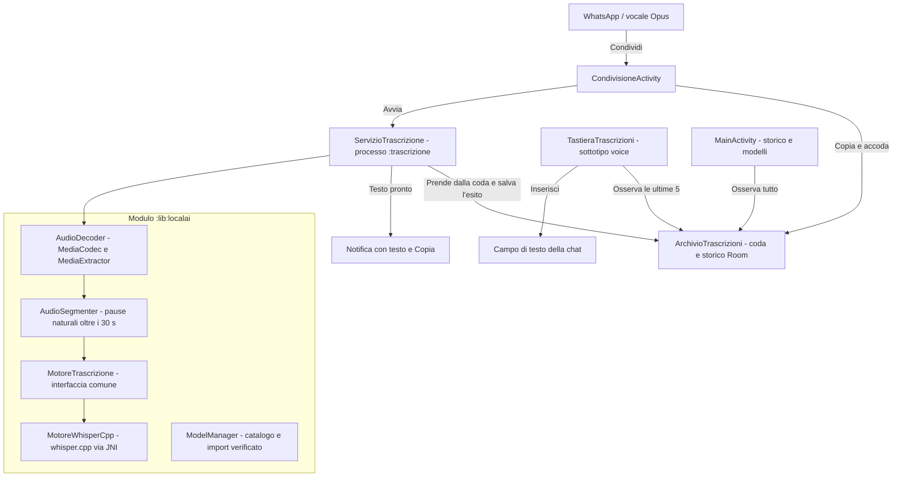

# PoldoKeyboard — Trascrizione in locale dei vocali

**PoldoKeyboard** trascrive sul telefono, senza rete, i messaggi vocali ricevuti su WhatsApp, Telegram e app simili, con i modelli **Whisper** eseguiti da **whisper.cpp**. Privilegia la qualità del testo rispetto alla velocità.

Non è una tastiera completa: per scrivere si continua a usare la propria tastiera (per esempio SwiftKey). PoldoKeyboard aggiunge una **tastiera di sola trascrizione**, come la digitazione vocale di Google, da cui inserire il testo dei vocali nella chat.

> **Stato:** il flusso completo funziona sul telefono di test (Motorola Edge 50 Fusion, Android 16) con Whisper Small: un vocale breve è pronto in meno di 20 secondi. Il motore è compilato solo per arm64-v8a; altrove risulta non disponibile.

---

## Come si usa

1. **Condividi il vocale.** In WhatsApp tieni premuto un vocale → Condividi → **Trascrivi con PoldoKeyboard**. Si possono condividere anche più vocali insieme. Non si apre nessuna finestra: il vocale viene copiato nella memoria privata dell'app, messo in coda, e resti nella chat.
2. **La trascrizione avviene in background**, in un servizio con la notifica di avanzamento, anche a schermo spento.
3. **Arriva una notifica con il testo completo**, leggibile dalla tendina, con il pulsante **Copia**.
4. **Per inserirlo nella risposta** passa alla tastiera *PoldoKeyboard Trascrizioni* con il tasto di cambio tastiera: tocca una trascrizione per leggerla tutta, poi **Inserisci** la scrive nel campo e ti riporta alla tua tastiera.
5. **Nell'app** trovi lo storico completo, la gestione dei modelli e il test delle prestazioni.

---

## Architettura



- **`:app`** (`io.github.donatogranvilla.poldokeyboard`): condivisione, archivio Room condiviso tra i processi, servizio in primo piano nel processo `:trascrizione`, notifiche, tastiera di trascrizione e schermata dell'app (Compose, Material 3 con i colori del telefono).
- **`:lib:localai`**: decodifica dell'audio, segmentazione, motori di trascrizione, catalogo e import dei modelli, benchmark. whisper.cpp 1.9.4 è un submodule git in `lib/localai/src/main/cpp/whisper.cpp`, compilato per arm64-v8a con le istruzioni ARMv8.2 dotprod e fp16.
- **Isolamento**: il motore gira in un processo separato; se esaurisce la memoria si chiude quel processo, non l'app.

---

## Modelli

L'app non ha il permesso INTERNET: i modelli si scaricano con il browser (pulsante **Scarica dal browser**) e si importano con il selettore di sistema. L'impronta SHA-256 riconosce il modello del catalogo; i file fuori catalogo, come i Whisper specializzati in italiano, si accettano attivando l'interruttore apposito.

| Modello | File | Dimensione |
| :--- | :--- | ---: |
| Whisper Tiny (Q5_1) | `ggml-tiny-q5_1.bin` | 32 MB |
| Whisper Base (Q5_1) | `ggml-base-q5_1.bin` | 60 MB |
| Whisper Small (Q5_1) | `ggml-small-q5_1.bin` | 190 MB |
| Whisper Medium (Q5_0) | `ggml-medium-q5_0.bin` | 539 MB |
| Whisper Large v3 Turbo (Q5_0) | `ggml-large-v3-turbo-q5_0.bin` | 574 MB |
| Whisper Large v3 Turbo (Q8_0) | `ggml-large-v3-turbo-q8_0.bin` | 874 MB |
| Whisper Large v3 (Q5_0) | `ggml-large-v3-q5_0.bin` | 1,08 GB |

Il modello predefinito lo sceglierà il benchmark sui vocali reali (fase F4 del piano). Il **Test Prestazioni**, nella gestione dei modelli, misura intanto la velocità (RTF) su quattro vocali sintetici.

---

## Privacy e licenze

- Nessun backend, nessuna API cloud, nessuna telemetria; l'app non ha il permesso INTERNET.
- I vocali condivisi e le trascrizioni restano nella memoria privata dell'app finché non li elimini, e sono esclusi dal backup. Il testo copiato è segnato come sensibile negli appunti.
- Licenze: whisper.cpp e ggml MIT, modelli Whisper MIT, librerie AndroidX e Kotlin Apache-2.0. Nessuna dipendenza GPL. Dettagli in [`THIRD_PARTY_LICENSES/README.md`](THIRD_PARTY_LICENSES/README.md).
- Il progetto è nato come fork di FlorisBoard (Apache-2.0); dal branch `modulo-trascrizione` non ne contiene più il codice.

---

## Compilazione

Prerequisiti: JDK 17 o successivo, Android SDK con compileSdk 37, NDK e CMake (le versioni sono in `gradle/tools.versions.toml`; sul PC di sviluppo si possono sostituire con `poldo.ndkVersion` e `poldo.cmakeVersion` nel `gradle.properties` dell'utente).

```bash
git submodule update --init
./gradlew :app:assembleDebug
```

L'APK è in `app/build/outputs/apk/debug/app-debug.apk`. Le build di debug, locali e della CI, sono firmate con la chiave del progetto `app/debug.keystore`: un APK nuovo si installa sopra il precedente senza perdere modelli e storico.

La CI (GitHub Actions) compila a ogni push, pubblica l'APK tra gli artifact della run ed esegue i test unitari senza bloccare l'APK.
