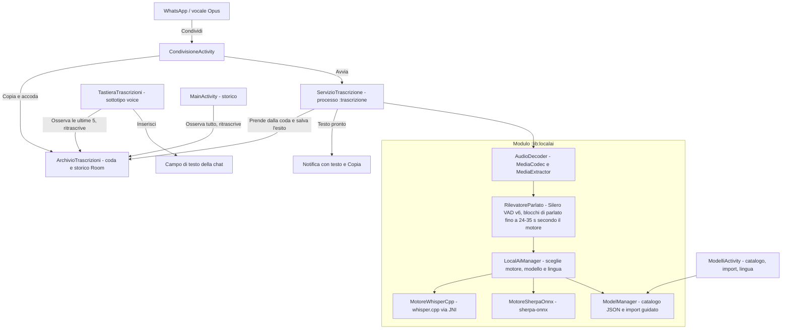

# PoldoKeyboard — trascrivi i vocali di WhatsApp sul telefono, senza mandarli su internet

> Ti è arrivato un vocale di quattro minuti e sei in riunione? Poldo lo ascolta al posto tuo e te lo scrive. Tutto sul telefono: il vocale non va da nessuna parte.

**PoldoKeyboard** è un'app Android gratuita e open source che **trascrive i messaggi vocali** di **WhatsApp**, **Telegram** e di altre app **direttamente sul telefono**, con l'intelligenza artificiale e **senza inviare l'audio a nessun server**. Condividi il vocale, aspetti la notifica, e il testo è pronto: lo leggi, lo copi, oppure lo inserisci nella risposta da una tastiera dedicata, senza uscire dalla chat.

Sotto il cofano lavorano gli stessi modelli di riconoscimento vocale (*speech-to-text*) dei servizi cloud, eseguiti in locale: **Whisper** di OpenAI con **whisper.cpp**, e **Parakeet**, **GigaAM**, **Moonshine** e **Omnilingual** con **sherpa-onnx**. Prima la qualità del testo, poi la velocità.

### Perché ti piacerà

- 🔒 **Privacy vera.** L'audio e le trascrizioni non lasciano mai il telefono. Niente account, niente pubblicità, niente telemetria.
- 📴 **Funziona offline.** Una volta scaricato il modello, trascrive anche in aereo o in montagna.
- ⌨️ **Una tastiera che fa una cosa sola.** Non sostituisce la tua tastiera (SwiftKey, Gboard o altre): ci passi un attimo, tocchi la trascrizione, **Inserisci**, e torni a scrivere come prima.
- 🧠 **Il modello lo scegli tu.** 35 modelli per 14 lingue, compresi alcuni specializzati in italiano. Se un testo non ti convince, **Ritrascrivi con…** un modello più grande.
- 🤫 **Niente frasi inventate sul silenzio.** Prima di trascrivere, un rilevatore del parlato (Silero VAD) toglie silenzi e rumore, dove i modelli tendono ad avere le allucinazioni.
- 📚 **Lavora in background**, anche a schermo spento e con più vocali in coda.

### Per chi è

- Per chi riceve vocali lunghi e non può ascoltarli: in ufficio, in treno, in biblioteca, con un bambino che dorme accanto.
- Per chi preferisce leggere invece di ascoltare, o ha difficoltà uditive.
- Per chi non vuole che i propri vocali passino dai server di qualcun altro.

### A che punto è

Il progetto è giovane ma funziona: sul telefono di test (Motorola Edge 50 Fusion, Android 16) **Parakeet v3 trascrive un vocale di due minuti e mezzo in circa 17 secondi**, con la punteggiatura. Whisper è più lento ma su alcune parole più preciso.

- Serve un telefono **Android 8.0 o successivo a 64 bit (arm64)**: su altri processori i motori non sono disponibili.
- L'interfaccia è in italiano e in inglese.
- **Non c'è ancora una release ufficiale.** L'APK si scarica dagli artifact della CI su GitHub Actions, che richiedono di aver fatto l'accesso a GitHub.

### In English

**PoldoKeyboard** is a free, open-source Android app that **transcribes WhatsApp and Telegram voice messages on your phone, fully offline**, with **on-device speech-to-text**: OpenAI **Whisper** through whisper.cpp, and NVIDIA **Parakeet**, GigaAM, Moonshine and Omnilingual through sherpa-onnx. Share a voice note, get a notification with the text, and insert it into your reply from a transcription-only keyboard. No cloud, no account, no ads: the audio never leaves the phone. The interface is in English and Italian, with models for 14 languages.

---

## Come si usa

1. **Condividi il vocale.** In WhatsApp tieni premuto un vocale → Condividi → **Trascrivi con PoldoKeyboard**. Si possono condividere anche più vocali insieme. Non si apre nessuna finestra: il vocale viene copiato nella memoria privata dell'app, messo in coda, e resti nella chat.
2. **La trascrizione avviene in background**, in un servizio con la notifica di avanzamento, anche a schermo spento.
3. **Arriva una notifica con il testo completo**, leggibile dalla tendina, con il pulsante **Copia**.
4. **Per inserirlo nella risposta** passa alla tastiera *PoldoKeyboard Trascrizioni* con il tasto di cambio tastiera: tocca una trascrizione per leggerla tutta, poi **Inserisci** la scrive nel campo e ti riporta alla tua tastiera.
5. **Se il testo non convince**, **Ritrascrivi con…**, nello storico dell'app o nella tastiera, rifà la trascrizione con un altro modello installato, per esempio uno più grande. Il testo precedente resta finché non arriva quello nuovo.
6. **Nell'app** trovi lo storico completo e la schermata **Modelli**, con il test delle prestazioni.

---

## Architettura



- **`:app`** (`io.github.donatogranvilla.poldokeyboard`): condivisione, archivio Room condiviso tra i processi, servizio in primo piano nel processo `:trascrizione`, notifiche, tastiera di trascrizione, storico e schermata dei modelli (Compose, Material 3 con i colori del telefono).
- **`:lib:localai`**: decodifica dell'audio, rilevamento del parlato con Silero VAD v6 (l'unico modello incluso nell'APK, 885 KB), motori di trascrizione, catalogo e import dei modelli, benchmark. whisper.cpp 1.9.4 è un submodule git in `lib/localai/src/main/cpp/whisper.cpp`, compilato per arm64-v8a in sette varianti del backend CPU, da ARMv8.0 ad ARMv9.2 con SVE2 e SME: all'avvio si carica la più veloce che il processore supporta, così l'app gira sui telefoni vecchi e sfrutta le istruzioni di quelli nuovi. sherpa-onnx 1.13.8 arriva come libreria già compilata della release ufficiale, con ONNX Runtime incluso, insieme alla sua API Kotlin.
- **Isolamento**: il motore gira in un processo separato; se esaurisce la memoria si chiude quel processo, non l'app.

---

## Modelli

Due motori: **whisper.cpp** per i modelli Whisper in formato GGML, un solo file `ggml-*.bin`, e **sherpa-onnx** per Parakeet, GigaAM, Moonshine, Omnilingual e gli altri modelli ONNX, un archivio `.tar.bz2` con più file. L'app sceglie il motore in base al modello e ne tiene in memoria uno solo.

Quale scegliere per l'italiano? Su 101 vocali veri **Whisper large-v3-turbo** sbaglia l'11,7% delle parole e **Parakeet TDT 0.6B v3**, più veloce, il 14,8%: la classifica completa e il metodo sono in [Quale modello trascrive meglio i vocali italiani?](docs/prova-dei-modelli.md).

La schermata **Modelli** si apre dall'app e dalla tastiera di trascrizione:

- **Catalogo** di 35 modelli per 14 lingue, filtrabile per lingua: prima gli specializzati, poi i multilingue. Ogni scheda indica lingue, accuratezza, velocità, peso, RAM consigliata, file da scaricare, licenza e pagina del modello. Il catalogo è un file di dati, `lib/localai/src/main/resources/catalogo_modelli.json`.
- **Aggiorna l'elenco** scarica da GitHub, solo quando lo tocchi, il catalogo pubblicato in questo repository: così i modelli nuovi arrivano senza aggiornare l'app. Le voci che una versione vecchia dell'app non sa leggere si saltano, e dopo un aggiornamento dell'app vale di nuovo il catalogo incluso.
- **Scarica** apre il file nel browser; **Importa** lo installa dal selettore di sistema. Il file si riconosce dall'impronta SHA-256 e dai primi byte. I modelli del catalogo si installano da soli; per gli altri l'app chiede nome, lingue e tipo. Per i formati che non vanno (GGUF, safetensors, PyTorch, un ONNX singolo) spiega cosa scaricare al loro posto.
- **Lingua dei vocali**: i modelli specializzati usano sempre la loro lingua; per i multilingue si sceglie una lingua fissa oppure il riconoscimento automatico.
- Una **guida** spiega quale file scaricare (quantizzazioni q5, q8 e f16; versioni int8) e dove cercare altri modelli.

### Aggiornare il catalogo

Il catalogo è [`lib/localai/src/main/resources/catalogo_modelli.json`](lib/localai/src/main/resources/catalogo_modelli.json), un elenco JSON di voci come quelle già presenti. L'app lo scarica dal **branch predefinito** del repository, allo stesso percorso.

- Per pubblicare un modello nuovo o una correzione basta un commit sul branch predefinito: le app installate lo ricevono al prossimo **Aggiorna l'elenco**. GitHub può servire la versione precedente ancora per qualche minuto.
- Non spostare né rinominare il file: le versioni già installate non lo troverebbero più.
- Ogni voce deve avere un id unico, il nome, la dimensione, lo SHA-256 di 64 cifre esadecimali, un `tipoMotore` coerente con l'`architettura` e indirizzi `https://`. Il test `LetturaCatalogoTest` controlla tutto il file; l'app salta le voci non valide.
- Un'architettura nuova va prima aggiunta al codice: le versioni vecchie dell'app salteranno quelle voci e lo diranno all'utente.

| Lingua | Specializzati nel catalogo | Multilingue che la coprono |
| :--- | :--- | :--- |
| Italiano | Whisper Turbo, Distil e Large v3 italiani | Parakeet v3, NeMo multilingue, Whisper, Omnilingual |
| Inglese | Parakeet v2, Moonshine | Parakeet v3, NeMo multilingue, Whisper, Omnilingual |
| Spagnolo | Whisper Turbo latinoamericano, NeMo FastConformer, Moonshine (non commerciale) | Parakeet v3, NeMo multilingue, Whisper, Omnilingual |
| Francese | tre Whisper Large v3 distillati | Parakeet v3, NeMo multilingue, Whisper, Omnilingual |
| Tedesco | Whisper Turbo, NeMo FastConformer | Parakeet v3, NeMo multilingue, Whisper, Omnilingual |
| Portoghese | Whisper Distil e NeMo FastConformer (non commerciale), entrambi brasiliani | Parakeet v3, Whisper, Omnilingual |
| Catalano | nessuno pronto per il telefono | Whisper, Omnilingual |
| Russo | GigaAM v3, con e senza punteggiatura; Whisper Podlodka Turbo | Parakeet v3, NeMo multilingue, Whisper, Omnilingual |
| Croato | Whisper Turbo ParlaSpeech | Parakeet v3, NeMo multilingue, Whisper, Omnilingual |
| Sloveno | Whisper Small | Parakeet v3, Whisper, Omnilingual |
| Albanese | Whisper Small FUTO | Whisper, Omnilingual |
| Greco | Whisper Small FUTO | Parakeet v3, Whisper, Omnilingual |
| Turco | Whisper Large v3 | Whisper, Omnilingual |
| Arabo marocchino | Whisper Turbo arabo dialettale | Whisper, Omnilingual |

"Whisper" sono i sette modelli ufficiali, da Tiny a Large v3. Il NeMo multilingue è segnato come non commerciale perché la sua licenza NGC non dichiara l'uso commerciale. Alcuni Whisper specializzati sono conversioni GGML di terze parti, indicate nella descrizione: l'impronta garantisce che il file sia quello del catalogo, non chi l'ha convertito.

Il modello predefinito lo sceglierà il benchmark sui vocali reali (fase F4 del piano). Intanto il **Test delle prestazioni**, nella schermata Modelli, misura la velocità (RTF) su quattro vocali sintetici.

---

## Privacy e licenze

- Nessun backend, nessuna API cloud, nessuna telemetria. L'app ha il permesso INTERNET per un solo scopo: scaricare il catalogo dei modelli da `raw.githubusercontent.com` quando tocchi **Aggiorna l'elenco**. I vocali e le trascrizioni non lasciano mai il telefono. Tutto il codice di rete sta in un file, [`ScaricatoreCatalogo.kt`](lib/localai/src/main/kotlin/io/github/donatogranvilla/poldokeyboard/localai/model/ScaricatoreCatalogo.kt), e la CI fallisce se classi di rete compaiono altrove.
- I vocali condivisi e le trascrizioni restano nella memoria privata dell'app finché non li elimini, e sono esclusi dal backup. Il testo copiato è segnato come sensibile negli appunti.
- Licenze del codice: whisper.cpp e ggml MIT, sherpa-onnx Apache-2.0 con ONNX Runtime MIT, Apache Commons Compress, AndroidX e Kotlin Apache-2.0. Nessuna dipendenza GPL. I modelli hanno licenze proprie (MIT, Apache-2.0, CC-BY-4.0); i pochi non commerciali sono segnalati nell'app. Dettagli in [`THIRD_PARTY_LICENSES/README.md`](THIRD_PARTY_LICENSES/README.md).
- Il progetto è nato come fork di FlorisBoard (Apache-2.0) e oggi non ne contiene più il codice; da lì restano solo parti della configurazione di build, indicate nella `LICENSE`.

---

## Compilazione

Prerequisiti: JDK 17 o successivo, Android SDK con compileSdk 37, NDK e CMake (le versioni sono in `gradle/tools.versions.toml`; sul PC di sviluppo si possono sostituire con `poldo.ndkVersion` e `poldo.cmakeVersion` nel `gradle.properties` dell'utente).

```bash
git submodule update --init
./gradlew :app:assembleDebug
```

L'APK è in `app/build/outputs/apk/debug/app-debug.apk`. Le build di debug, locali e della CI, sono firmate con la chiave del progetto `app/debug.keystore`: un APK nuovo si installa sopra il precedente senza perdere modelli e storico.

La CI (GitHub Actions) compila a ogni push, pubblica l'APK tra gli artifact della run ed esegue i test unitari senza bloccare l'APK.
