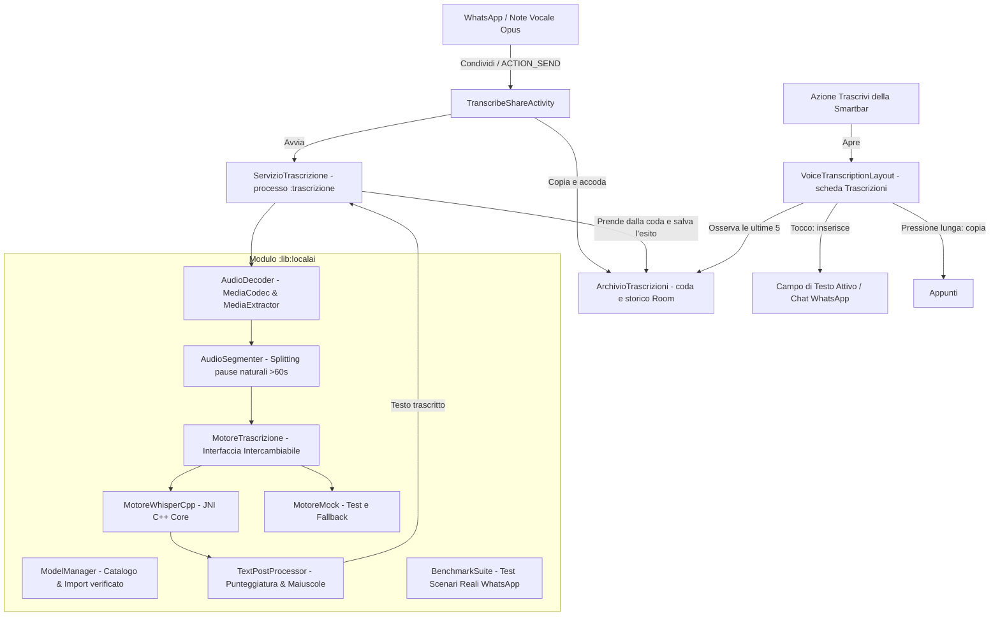

# PoldoKeyboard — Tastiera Android con trascrizione dei vocali in locale

**PoldoKeyboard** è una tastiera Android basata su **FlorisBoard** (Apache-2.0) che trascrive in locale i messaggi vocali con i modelli **Whisper** (MIT).

> **Stato:** il motore nativo whisper.cpp non è ancora integrato (fase F2 del piano). Finché manca, la trascrizione non è reale.

Il progetto è concepito specificamente per:
1. **Trascrivere i messaggi vocali di WhatsApp** tramite il menu di condivisione di sistema (`ACTION_SEND`, o `ACTION_SEND_MULTIPLE` per più vocali insieme), senza abbandonare la chat: il vocale entra in coda, un servizio lo trascrive in un processo separato e il testo compare nella scheda Trascrizioni della tastiera.
2. **Rispondere dalla tastiera**: la scheda Trascrizioni mostra le ultime trascrizioni e **inserisce il testo nel campo attivo** con un tocco. La dettatura dal microfono è rimandata a dopo la v1.
3. **Garantire il 100% di Privacy**: nessun backend remoto, nessuna API cloud, nessun account utente, zero analytics e zero telemetria. Tutto l'audio viene decodificato ed elaborato localmente nella RAM del dispositivo.
4. **Massima Libertà Commerciale**: nessuna dipendenza virale (zero GPL/AGPL). Base Apache-2.0 e componenti ASR con licenza MIT.
5. **Personalizzazione Immediata del Brand**: il nome del progetto è provvisorio e centralizzato in un unico file per essere sostituito in pochi secondi.

---

## 🏗️ Architettura del Sistema



---

## 🚀 Funzionalità Principali

### 1. Workflow WhatsApp Nativo
- Tieni premuto qualsiasi messaggio vocale su WhatsApp -> tocca **Condividi** -> seleziona **"Trascrivi con PoldoKeyboard"**. Si possono condividere anche più vocali insieme.
- Non si apre nessuna finestra: il vocale viene copiato nella memoria privata dell'app e messo in coda, un breve avviso lo conferma e resti nella chat.
- [`ServizioTrascrizione`](app/src/main/kotlin/dev/patrickgold/florisboard/ime/voice/ServizioTrascrizione.kt) trascrive la coda in un processo separato (`:trascrizione`), con una notifica di avanzamento, anche a schermo spento. Se il motore esaurisce la memoria si chiude quel processo, non la tastiera.
- La decodifica nativa `MediaExtractor` / `MediaCodec` converte direttamente il formato WhatsApp `.opus` (Ogg container) in campioni PCM a 16 kHz Mono senza librerie pesanti come FFmpeg.
- Il testo comparirà nella scheda Trascrizioni della tastiera, che si aprirà da sola al ritorno nella chat (in sviluppo).

### 2. Scheda Trascrizioni nella tastiera
- Si apre con l'azione **Trascrivi** della Smartbar (`VoiceTranscriptionLayout`). Il tasto voce resta quello di FlorisBoard e passa alla tastiera vocale di sistema.
- Mostra le ultime 5 trascrizioni con il loro stato: in coda, in corso con la percentuale, pronta o non riuscita. Lo storico completo resta nell'archivio finché non lo svuoti.
- **Tocco**: inserisce il testo nel campo della chat e torna alla tastiera. **Pressione lunga**: copia il testo negli appunti.
- Per ogni trascrizione: elimina, e riprova se non è riuscita. Dall'intestazione: gestione dei modelli e pulizia completa, con conferma.
- Usa gli stili del pannello Appunti, quindi segue il tema della tastiera; a telefono bloccato i testi restano nascosti.
- La dettatura dal microfono è rimandata a dopo la v1: l'app non chiede il permesso `RECORD_AUDIO`.

### 3. Gestione Vocali Lunghi (> 60 secondi)
- I modelli Whisper operano internamente su finestre di 30 secondi.
- Il modulo [`AudioSegmenter`](file:///c:/Dev/PoldoKeyboard/lib/localai/src/main/kotlin/org/florisboard/lib/localai/audio/AudioSegmenter.kt) rileva le pause di respirazione e i punti a minore energia sonora (RMS) tra 10s e 28s.
- Suddivide vocali di 60s, 90s, 3 minuti o superiori in blocchi continui senza tagliare parole a metà.
- Ogni blocco viene elaborato con avanzamento percentuale fluido e ricongiunto con punteggiatura naturale.

### 4. Modelli Intercambiabili e Riconoscimento Hardware
Il catalogo ([`ModelCatalog`](lib/localai/src/main/kotlin/org/florisboard/lib/localai/model/ModelCatalog.kt)) comprende tutti i modelli Whisper da tiny a large-v3; il predefinito lo sceglierà il benchmark sui vocali reali. Fino ad allora la tastiera ne consiglia uno in base alla RAM ([`ProfiloDispositivo`](lib/localai/src/main/kotlin/org/florisboard/lib/localai/model/ProfiloDispositivo.kt)). La RAM dei modelli da medium in su è una stima da misurare.

| Modello | File | Dimensione | RAM stimata |
| :--- | :--- | ---: | ---: |
| Whisper Tiny (Q5_1) | `ggml-tiny-q5_1.bin` | 32 MB | ~200 MB |
| Whisper Base (Q5_1) | `ggml-base-q5_1.bin` | 60 MB | ~400 MB |
| Whisper Small (Q5_1) | `ggml-small-q5_1.bin` | 190 MB | ~900 MB |
| Whisper Medium (Q5_0) | `ggml-medium-q5_0.bin` | 539 MB | ~1 GB |
| Whisper Large v3 Turbo (Q5_0) | `ggml-large-v3-turbo-q5_0.bin` | 574 MB | ~1 GB |
| Whisper Large v3 Turbo (Q8_0) | `ggml-large-v3-turbo-q8_0.bin` | 874 MB | ~1,3 GB |
| Whisper Large v3 (Q5_0) | `ggml-large-v3-q5_0.bin` | 1,08 GB | ~2 GB |

Parakeet TDT 0.6B v3 (sherpa-onnx) entrerà nel catalogo insieme al suo motore. Con le opzioni sviluppatore attive si può importare anche un file GGML fuori catalogo.

### 5. Suite di Benchmark & Test Prestazioni
- Accessibile dal pulsante **"🚀 Test Prestazioni"** nella gestione modelli.
- Esegue 4 scenari realistici WhatsApp:
  1. *Vocale Breve* (8s)
  2. *Vocale Standard* (30s)
  3. *Vocale Lungo* (75s con verifica splitting)
  4. *Vocale Rumoroso* (20s con basso SNR)
- Calcola in tempo reale il **Real-Time Factor (RTF)** (`tempoInferenza / durataAudio`) e il delta di memoria RAM.

---

## 🏷️ Nome dell'app

- Il nome visibile (launcher, elenco delle tastiere, frasi che citano l'app) è la risorsa `floris_app_name`, non tradotta:
  - release: `app/src/main/res/values/strings_dont_translate.xml`
  - debug: `app/src/debug/res/values/strings.xml`
  - beta: `app/src/beta/res/values/strings.xml`
- Le stringhe aggiunte da PoldoKeyboard, compresa l'etichetta del menu Condividi `localai_share_action_label`, stanno in `strings_poldo.xml` (inglese e italiano). Così i file `strings.xml` di FlorisBoard restano identici all'originale.
- L'applicationId è ancora quello di FlorisBoard: va scelto prima della prima release. Le build di debug si installano già accanto a FlorisBoard grazie al suffisso `.debug`.

---

## ⚖️ Conformità Licenze e Distribuzione Commerciale

Il progetto rispetta rigorosamente i vincoli per la distribuzione commerciale senza obblighi di copyleft virale:

- **Codice Base (FlorisBoard)**: Licenza **Apache-2.0** (permette l'uso commerciale, modifica e redistribuzione con mantenimento del file NOTICE).
- **Motore ASR (whisper.cpp)**: Licenza **MIT** (permette l'uso commerciale senza restrizioni).
- **Modelli GGML Whisper (OpenAI / ggerganov)**: Licenza **MIT** (pesi aperti a distribuzione e uso commerciale).
- **Librerie di Supporto**: AndroidX, Jetpack Compose, Kotlinx Serialization, Coroutines (tutte **Apache-2.0**).
- **Zero Dipendenze GPL/LGPL**: nessun modulo introduce licenze GPL (ad es. AnySoftKeyboard usa GPL-3.0 ed è stato scartato; FFmpeg con licenze GPL è stato evitato a favore di `MediaCodec` nativo Android).

La matrice dettagliata è consultabile in [`THIRD_PARTY_LICENSES/README.md`](file:///c:/Dev/PoldoKeyboard/THIRD_PARTY_LICENSES/README.md).

---

## 🛠️ Istruzioni di Compilazione

### Prerequisiti
- **JDK**: Java 21 (es. OpenJDK 21)
- **Android SDK**: Compile/Target SDK 37 (API 37 preview)
- **Android NDK**: r27c (`27.2.12479018`)
- **CMake & Ninja**: CMake 3.22+ e Ninja

### Compilazione APK Debug
```powershell
$env:JAVA_HOME = "C:\Program Files\Android\openjdk\jdk-21.0.8"
$env:PATH = "$env:JAVA_HOME\bin;C:\Program Files\Microsoft Visual Studio\18\Professional\Common7\IDE\CommonExtensions\Microsoft\CMake\CMake\bin;C:\Program Files\Microsoft Visual Studio\18\Professional\Common7\IDE\CommonExtensions\Microsoft\CMake\Ninja;" + $env:PATH
.\gradlew.bat :app:assembleDebug --max-workers=2
```
L'APK generato si troverà in:
`app/build/outputs/apk/debug/app-debug.apk`

### Esecuzione Test Unitari
```powershell
.\gradlew.bat :lib:localai:test --max-workers=2
```

### Compilazione APK Release per Distribuzione Commerciale
1. Genera il keystore di firma:
   ```bash
   keytool -genkey -v -keystore release.jks -keyalg RSA -keysize 2048 -validity 10000 -alias localai
   ```
2. Configura le credenziali di firma in `local.properties`:
   ```properties
   signing.storeFile=/percorso/release.jks
   signing.storePassword=tua_password
   signing.keyAlias=localai
   signing.keyPassword=tua_password
   ```
3. Avvia la build di release:
   ```powershell
   .\gradlew.bat :app:assembleRelease --max-workers=2
   ```
   L'APK firmato e ottimizzato con Proguard/R8 sarà disponibile in:
   `app/build/outputs/apk/release/app-release.apk`
