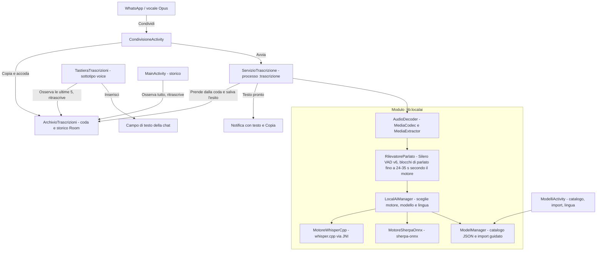

# PoldoKeyboard per chi sviluppa

Come è fatta l'app, come si aggiorna il catalogo dei modelli e come si compila. Per usare l'app basta il [README](../README.md).

## Architettura



- **`:app`** (`io.github.donatogranvilla.poldokeyboard`): condivisione, archivio Room condiviso tra i processi, servizio in primo piano nel processo `:trascrizione`, notifiche, tastiera di trascrizione, storico e schermata dei modelli (Compose, Material 3 con i colori del telefono).
- **`:lib:localai`**: decodifica dell'audio, rilevamento del parlato con Silero VAD v6 (l'unico modello incluso nell'APK, 885 KB), motori di trascrizione, catalogo e import dei modelli, benchmark.
  - whisper.cpp 1.9.4 è un submodule git in `lib/localai/src/main/cpp/whisper.cpp`, compilato per arm64-v8a in sette varianti del backend CPU, da ARMv8.0 ad ARMv9.2 con SVE2 e SME: all'avvio si carica la più veloce che il processore supporta.
  - sherpa-onnx 1.13.8 arriva come libreria già compilata della release ufficiale, con ONNX Runtime incluso, insieme alla sua API Kotlin.
- **Isolamento**: il motore gira in un processo separato; se esaurisce la memoria si chiude quel processo, non l'app.

## Il catalogo dei modelli

Il catalogo è [`lib/localai/src/main/resources/catalogo_modelli.json`](../lib/localai/src/main/resources/catalogo_modelli.json), un elenco JSON. L'app ne include una copia e, quando l'utente tocca **Aggiorna l'elenco**, scarica quella del branch predefinito del repository, allo stesso percorso.

- Per pubblicare un modello nuovo o una correzione basta un commit sul branch predefinito: le app installate la ricevono al successivo **Aggiorna l'elenco**. GitHub può servire la versione precedente ancora per qualche minuto.
- Il file non va spostato né rinominato: le versioni già installate non lo troverebbero più.
- Ogni voce deve avere un id unico, il nome, la dimensione, lo SHA-256 di 64 cifre esadecimali, un `tipoMotore` coerente con l'`architettura` e indirizzi `https://`. Il test `LetturaCatalogoTest` controlla tutto il file; l'app salta le voci non valide.
- Un'architettura nuova va prima aggiunta al codice: le versioni vecchie dell'app salteranno quelle voci e lo diranno all'utente.
- Dopo un aggiornamento dell'app vale di nuovo il catalogo incluso, finché l'utente non tocca di nuovo **Aggiorna l'elenco**.

### Convertire un modello NeMo

Il workflow manuale **Converti un modello** (`.github/workflows/converti-modello.yml`) converte un modello NVIDIA NeMo nel formato di sherpa-onnx, lo prova su un audio di esempio e pubblica l'archivio con la sua impronta SHA-256 nella release `modelli` del repository. Da lì il catalogo può puntarci.

## L'unico uso della rete

Tutto il codice di rete sta in [`ScaricatoreCatalogo.kt`](../lib/localai/src/main/kotlin/io/github/donatogranvilla/poldokeyboard/localai/model/ScaricatoreCatalogo.kt), che scarica solo il catalogo, da un indirizzo fisso, senza redirect e fino a 1 MB. La CI fallisce se classi di rete compaiono in qualsiasi altro file.

## Compilazione

Prerequisiti: JDK 17 o successivo, Android SDK con compileSdk 37, NDK e CMake. Le versioni sono in `gradle/tools.versions.toml` e si possono sostituire con `poldo.ndkVersion` e `poldo.cmakeVersion` nel proprio `gradle.properties` di utente.

```bash
git submodule update --init
./gradlew :app:assembleDebug
```

L'APK è in `app/build/outputs/apk/debug/app-debug.apk`. Le build di debug, locali e della CI, sono firmate con la chiave del progetto `app/debug.keystore`, così un APK nuovo si installa sopra il precedente senza perdere modelli e storico.

La CI (GitHub Actions) compila a ogni push, pubblica l'APK tra gli artifact della run ed esegue i test unitari.

## Pubblicare una versione

Le versioni per chi usa l'app sono build di release, ottimizzate da R8, con il nome di pacchetto senza `.debug`: sul telefono convivono con le build di debug. Le firma una chiave privata che non sta nel repository; il workflow **Pubblica una versione** (`.github/workflows/rilascio.yml`) la prende dai secret `POLDO_FIRMA_CHIAVE` (il file PKCS12 in base64) e `POLDO_FIRMA_PASSWORD`, e si ferma se l'APK non porta il certificato del progetto.

1. In `gradle.properties` aumenta `projectVersionCode` e scrivi la nuova `projectVersionName`, per esempio `0.3.0` o `0.3.0-beta.1`.
2. Crea e pubblica il tag con la stessa versione preceduta da `v`, per esempio `v0.3.0`.

Il workflow compila, controlla e crea la release con l'APK e la sua impronta. Un tag con un trattino crea un'anteprima.
